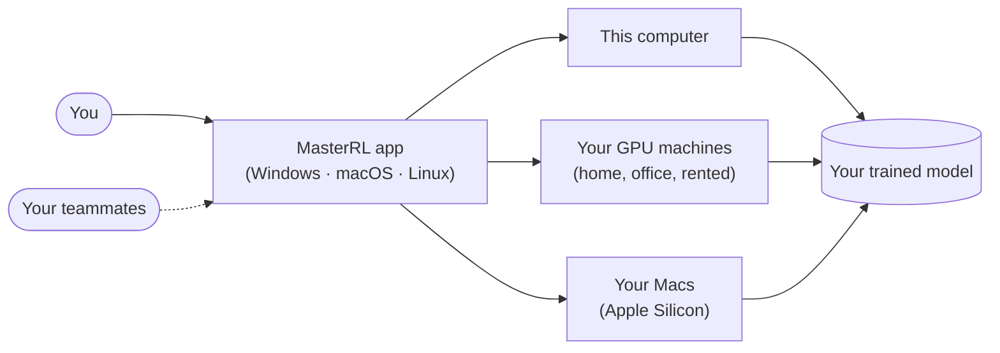

# MasterRL

Train and improve AI models on your own computers, from one simple desktop app.

**Status:** in development.

## How it works

1. **Install the app** and sign in once with Google or GitHub.
2. **Connect your machines**: this computer, GPU boxes you own or rent, or a Mac. The app checks each one and tells you, in plain words, what it can do.
3. **Pick a goal**, like "answer questions about my documents" or "get better at math". The app suggests a method and a model size that fit your hardware.
4. **Train.** Watch progress live. Training keeps running even if you close the app, and it saves often, so nothing is lost if something crashes.
5. **Try and compare** your new model against the original, then export it.

## What you can do

- Fine-tune models on a laptop GPU or a big server
- Teach models with rewards and feedback (reinforcement learning, RLHF)
- Bring your own data, benchmarks and AI judges
- Share your machines with a team, fairly
- Train on NVIDIA (Linux, or Windows via WSL2) and Apple Silicon

## Your data stays yours

Everything runs on your machines. Only your email and name are used for sign-in. Your data, models and keys never leave your computers.

## License

Apache-2.0
